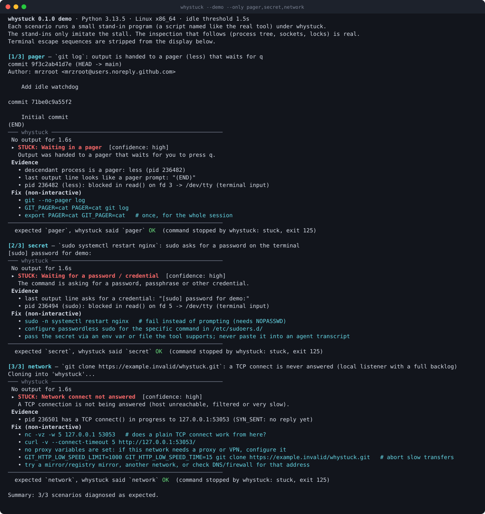

<p align="center"></p>

<p align="center">
  <a href="https://github.com/mrzroot/whystuck/releases"></a>
  <a href="LICENSE"></a>
  
  
  <a href="https://github.com/mrzroot/whystuck/commits"></a>
</p>

<p align="center"><a href="https://mrzroot.github.io/whystuck/">Website</a> · <a href="README.fa.md">فارسی</a> · <a href="CHANGELOG.md">Changelog</a> · <a href="CONTRIBUTING.md">Contributing</a></p>

<div align="center">

# whystuck

**Your command hung. `whystuck` tells you why, and what to run instead.**

Run any command with an idle watchdog. When it goes quiet, `whystuck` inspects the live process and says whether it is
waiting in a **pager**, an **editor**, a **y/N prompt**, a **password prompt**, **watch mode**, a **lock**, a stalled
**network connect**, or is simply a **server** or **busy**, with the evidence and the non-interactive fix.


English · [فارسی](README.fa.md)



<sub>Real output of <code>whystuck --demo --only pager,secret,network</code> (3 of 8 scenarios). Full transcript: <a href="docs/demo.txt">docs/demo.txt</a>.</sub>

</div>

## The problem

Humans and AI coding agents lose minutes, or whole sessions, to commands that wait silently:

- `git log` sits in `less`; `git commit` opens vim; `git rebase -i` opens an editor
- `apt install`, `npm init`, `rm -i` wait for `y`; `ssh` waits for a host-key answer
- `sudo`, `ssh`, `gpg` wait for a password on the terminal
- `vitest` / `jest` start in **watch mode** and never exit
- a dev server runs in the foreground (and that is *fine*, but it looks like a hang)
- `apt` waits for a lock held by another process; `git clone` waits on a connect that is never answered

A plain `timeout` just kills the command and says nothing. `whystuck` finds out **what it is waiting for** and prints the
**non-interactive way** to run that command.

## Install

`whystuck` is one Python file with no dependencies (Python 3.9+).

```bash
# from a clone (works today)
git clone https://github.com/mrzroot/whystuck && cd whystuck
pip install .            # installs the `whystuck` command

# or just copy the single file anywhere on your PATH
install -m755 whystuck.py ~/.local/bin/whystuck
```

> It is not published on PyPI yet (the name `whystuck` was free on PyPI, npm and GitHub on 2026-10-18).
> Until then install from the repository: `pip install git+https://github.com/mrzroot/whystuck`.

Try it without touching anything (offline, no keys, a few seconds per scenario):

```bash
whystuck --demo
```

## Usage

```text
whystuck [--idle 20] [--timeout 600] [--kill] [--json] [--stdin pty|null|closed] [--] COMMAND [ARGS...]
whystuck --explain PID [--tail-file FILE] [--json]
whystuck --demo [--only pager,editor,...]      whystuck --rules
```

```bash
whystuck -- git log                       # watch it; diagnose if it goes quiet for 20 s
whystuck --idle 10 --kill -- npm test     # stop the command if the verdict says "stuck"
whystuck --json --kill --idle 15 -- make  # machine-readable result for scripts and agents
whystuck --explain 12345                  # diagnose a process that is already hung (read-only)
printf 'y\n' | whystuck -- apt-get install jq   # piped stdin is forwarded to the command
```

What you see when `git log` is waiting in a pager:

```text
─── whystuck ───────────────────────────────────────────────────
 No output for 20s · pid 4242 · git log
 ▸ STUCK: Waiting in a pager  [confidence: high]
   Output was handed to a pager that waits for you to press q.
 Evidence
   • descendant process is a pager: less (pid 4243)
   • last output line looks like a pager prompt: "(END)"
   • pid 4243 (less): blocked in read() on fd 3 -> /dev/tty (terminal input)
 Fix (non-interactive)
   • git --no-pager log
   • GIT_PAGER=cat PAGER=cat git log
   • export PAGER=cat GIT_PAGER=cat   # once, for the whole session
────────────────────────────────────────────────────────────────
```

The command runs inside a pseudo-terminal, so it behaves as it would in your terminal (colours, pagers, prompts all appear).
Diagnoses go to **stderr**; **stdout** is the command's own output. If stdin is a terminal your keystrokes are forwarded.

### Options

| Option | Meaning |
|---|---|
| `--idle SECONDS` | Seconds without output before diagnosing (default 20). Typing into the command also counts as activity. |
| `--timeout SECONDS` | Stop the command after this long overall; `0` disables (default 600). |
| `--kill` | Stop the command (whole process group and session) when the verdict is **stuck**. Verdicts that are *not stuck* (server, sleeping, busy) are never killed. Without `--kill`, whystuck only reports and the command keeps running. |
| `--json` | Print one JSON document on stdout. The command's output is captured (last 4000 characters in `output_tail`), not streamed. |
| `--stdin pty\|null\|closed` | `pty` (default): the command gets the terminal. `null`: stdin is `/dev/null`. `closed`: stdin is closed. With `null`/`closed`, reads fail fast instead of blocking. |
| `--explain PID` | Diagnose an already running process (read-only). Without its output text, prompts like `[y/N]` cannot be recognised; pass `--tail-file FILE` with the text. |
| `--include-snapshot` | Include the raw evidence snapshot in `--json` output (useful for bug reports and new rules). |
| `--demo [--only LIST]` | Offline scenarios that stall on purpose. |
| `--rules` | Print the rule table. |
| `--color auto\|always\|never` | Colour control (`NO_COLOR` is respected). |

### Exit codes

| Code | Meaning |
|---|---|
| `N` | The command's own exit status is passed through (`128+SIGNAL` if it died from a signal). |
| `124` | `--timeout` reached; command stopped (same as GNU `timeout`). |
| `125` | A stall was diagnosed as **stuck** and the command was stopped (`--kill`). With `--explain`: the verdict is "stuck". |
| `126` / `127` | Command not executable / not found. |
| `2` | Usage error or unsupported platform. |

## For AI agents and harnesses

```bash
whystuck --json --kill --idle 20 -- <command>
```

```jsonc
{
  "tool": "whystuck", "version": "0.1.0",
  "command": ["python3", "-c", "input('Proceed? [y/N] ')"],
  "status": "stuck",            // exited | stuck | stopped | timeout
  "exit_code": 125,             // what whystuck exited with
  "child_exit_code": 143,       // null if the command was not reaped
  "stuck": true,
  "verdicts": [{
    "id": "confirm", "title": "Waiting for a yes/no answer", "stuck": true, "confidence": "high",
    "summary": "The command is waiting for a yes/no (or Enter) answer.",
    "evidence": ["last output line is a yes/no style prompt: \"Proceed? [y/N]\"",
                 "pid 149573 (python3): blocked in read() on fd 0 -> /dev/pts/6 (terminal input)"],
    "fixes": ["...", "printf 'y\\n' | whystuck -- ..."],
    "alternatives": [], "idle_seconds": 1.0, "at_seconds": 1.57, "notes": []
  }],
  "output_tail": "Proceed? [y/N] "
}
```
<sub>(Abridged; comments added for this README. The real output is plain JSON.)</sub>

Branch on `exit_code`: `125` means "stuck, read `verdicts[0].fixes` and re-run non-interactively"; `124` means timeout.
Paste [docs/AGENTS.snippet.md](docs/AGENTS.snippet.md) into your `AGENTS.md` / `CLAUDE.md` / rules file to make agents use it.

As a library (embed it in a harness):

```python
from whystuck import diagnose, classify

verdict = diagnose(pid, tail=last_terminal_output)   # JSON-serialisable dict; read-only
if verdict["stuck"]:
    print(verdict["id"], verdict["fixes"][0])
```

`classify(snapshot)` is a pure function over a plain-dict snapshot, so you can also feed it evidence you collected yourself.

## How detection works

1. The command runs on a PTY (`pty.fork`). whystuck streams its output and tracks the time of the last output byte
   (or last forwarded keystroke) and a rolling tail of the output (ANSI escapes stripped, `\r` overwrites resolved).
   It also remembers whether the terminal is on the **alternate screen** (`ESC[?1049h`).
2. When nothing happened for `--idle` seconds it takes **one snapshot** of the process tree (children plus anything still in the
   command's session). On Linux this uses `/proc` only:
   - `stat`, `cmdline`, `wchan`, and **`/proc/PID/syscall`** (a blocking `read` on an fd that points to a tty is the strongest "waiting for input" signal)
   - `fd/` links: which terminal is read, which files are open (e.g. `COMMIT_EDITMSG`), which sockets exist
   - `/proc/net/tcp{,6}` joined with the socket inodes: `LISTEN` and `SYN_SENT` sockets with their addresses
   - a 0.5 s CPU sample of the tree (this is what adds half a second to a diagnosis)
   - for lock messages: other processes that hold the named lock file open
3. `classify(snapshot)` walks an **ordered rule table** (`RULES`); the first rule whose evidence is present wins, other matching
   rules are reported as *also matched*. Each rule returns evidence lines, a fix list, and a **confidence** computed from how many
   independent signals agree (e.g. prompt text *and* a blocked tty read = high; text alone = medium).
4. If nothing matches, the verdict is **`unknown`** (confidence low) with the raw evidence. It never guesses.

The rule table, from `whystuck --rules`:

```text
  editor      stuck      an editor (vim/nano/emacs/code --wait/...) is in the process tree, or git says it is waiting for the editor
  pager       stuck      a pager (less/more/bat/delta/...) is in the tree, or the last line is (END) / --More--
  secret      stuck      last output line asks for a password, passphrase, code or username, or a pinentry/askpass helper runs
  confirm     stuck      last output line is a [y/N], (yes/no), 'Proceed?', 'Press Enter' style prompt
  watch       stuck      output says it is watching for changes, a known watch/TUI tool runs (vitest, jest, top, watch, ...), or the alternate screen is active
  follow      stuck      tail -f, journalctl -f, docker/kubectl logs -f, kubectl get -w
  lock        stuck      output mentions waiting for a lock, or a process is blocked in flock(); names the holder via /proc when visible
  network     stuck      a TCP socket in the tree is in SYN_SENT (Linux /proc/net/tcp, or lsof elsewhere)
  server      not stuck  a TCP socket in the tree is in LISTEN and no prompt was found
  stdin_wait  stuck      a process is blocked reading a terminal, but no specific prompt was recognised
  sleeping    not stuck  a `sleep` process is in the tree
  busy        not stuck  the process tree used >= 25% of a CPU core during the sample window
  unknown     stuck      fallback: nothing matched; prints raw evidence only (confidence low)
```

Tool-specific fixes exist for the common cases (git, apt, npm, ssh, sudo, gpg, docker, vitest, jest, systemd tools, ...).
For other tools the fix list falls back to generic advice (`--yes` style flags are suggested as "check `--help`", never asserted).

## Limits (read these)

- **Only silence is detected.** A program that hangs while printing a spinner or heartbeat forever is not idle, so it is not diagnosed.
- **Prompt detection looks at the last line of output.** A prompt that does not look like the patterns above (free-form questions such as
  `Name?`) is reported as `stdin_wait` (blocked on terminal input, medium confidence) or `unknown`. Bare `(y)` prompts are not recognised.
- **Editors and pagers are recognised by process name** (`vim`, `nano`, `emacs`, `less`, `bat`, `delta`, `code --wait`, ...). Custom wrappers with other names are not.
- **Network:** only a TCP connect that is *in progress* (`SYN_SENT`) is detected. DNS stalls, and connections that are established but silent
  (a hung HTTP response), are **not** diagnosed (they end up as `unknown`/`stdin_wait`/`busy` depending on the process). Only TCP, not UDP.
- **`server`** means "a TCP socket in the tree is listening and no prompt rule matched". It cannot tell a healthy server from a server that is also hung internally.
- **`busy`** means >= 25% of a core during a 0.5 s sample. An infinite loop looks exactly like a long computation.
- **Alternate-screen tracking** reads escape sequences per output chunk; a sequence split across two reads is missed.
- **Lock holders** are found by scanning other processes' `/proc/*/fd` for the named file. Processes of other users, or in other PID namespaces, may be invisible.
- **Containers / hardened kernels:** `/proc/PID/syscall` may be unreadable (ptrace restrictions). whystuck then says so in `notes`, falls back to
  `wchan`-based inference (lower confidence) and to output-text rules. `--explain` on a process that is not your descendant is most affected.
- **Piped stdin:** data is forwarded, but **EOF is not** (harness stdin is often `/dev/null`, and forwarding it would make every prompt fail instead of hang). Use `--stdin null` if you want EOF semantics.
- **`--kill`** sends SIGTERM to the process group and session, then SIGKILL after 2 s. On Linux whystuck becomes a *subreaper* so orphaned descendants are reaped.
- **`--json` includes the last 4000 characters of output** (`output_tail`) and, with `--include-snapshot`, command lines of the process tree.
  If your command prints secrets, they are in there. Proxy variable **values** are never printed (names only).
- Suggested fixes are suggestions. They come from a small table of well-known tools; check them before running anything destructive.

### Platforms

| Platform | Status |
|---|---|
| Linux | Full: `/proc` evidence, tested in CI (Python 3.9 to 3.13). |
| macOS / BSD | Best effort: the runner works (it needs only `pty`), evidence comes from `ps` and `lsof` (no syscall data, no lock holders). The code path is exercised on Linux in the tests (`WHYSTUCK_COLLECTOR=ps`) but **not tested on real macOS in v0.1**; the `network`/`lock` demo scenarios are skipped there. |
| Windows | Not supported (no POSIX pty). `whystuck` prints a clear message and exits `2`. Use WSL. `classify()` can still be imported. |

## How it compares

Searched on GitHub (repository search, 8 query variants), npm/PyPI name checks, and the web on **18 Oct 2026**.
**No existing tool found as of Oct 2026** that is a standalone, agent-agnostic runner that inspects a *live* stalled process and returns cause + fix.
This is the outcome of a search, not a guarantee: the AI-agent tooling space moves weekly and agent products contain private versions of similar heuristics.
Closest things found, and how they differ:

| Tool | What it does | Difference |
|---|---|---|
| [`pi-non-interactive`](https://www.npmjs.com/package/pi-non-interactive) | Injects env vars into one agent's bash tool so commands avoid prompts | Prevention for one agent; no detection, no diagnosis |
| [`lukeramsden/pi-prevent-stuck`](https://github.com/lukeramsden/pi-prevent-stuck) | Static block-list of known-bad commands inside one agent extension | Static list; no runtime inspection |
| [Majordomus rule](https://majordomus.dev/rules/project-commands-run-non-interactively-2/) and [CLI Agent Spec check](https://agentexperience.tech/checks/axc-c001/) | Guidance and rule checks for CLI authors | Advice for tool authors, not a runner |
| Embedded heuristics in IDE agents (e.g. [VS Code issue 313244](https://github.com/microsoft/vscode/issues/313244)) | Terminal tools that decide a command needs input | Inside one product; not reusable |
| [GNU `timeout`](https://www.gnu.org/software/coreutils/manual/html_node/timeout-invocation.html), CI `no_output_timeout` (e.g. [CircleCI](https://circleci.com/docs/configuration-reference/)) | Kill after a time or silence limit | Kill only: no cause, no fix |

whystuck complements these: use them to *prevent* prompts, use whystuck to find out *why* the one you missed is hanging.

## Development

```bash
pip install -e . pytest
pytest -q                      # 136 tests: pure rule tests, real-process integration tests (Linux), golden output
whystuck --demo                # end-to-end smoke test
python tests/record_fixtures.py   # re-record real snapshots under tests/fixtures/recorded/
```

The test suite includes a mutation-style check (removing any rule must break at least one case), 9 snapshots recorded from real
processes, real PTY runs for every rule, process-group cleanup checks, exit-code passthrough, and golden text output.
See [CONTRIBUTING.md](CONTRIBUTING.md) to add a rule: it is one function plus one row in `RULES`.

## License

MIT, see [LICENSE](LICENSE). Copyright (c) 2026 Mohammadreza Zare ([@mrzroot](https://github.com/mrzroot)).

## Contributing

Bug reports and ideas are welcome: open an [issue](../../issues/new/choose) (the templates ask for the steps and version we need). For code, read [CONTRIBUTING.md](CONTRIBUTING.md) first, keep each pull request to one change, and run the tests before you open it.
